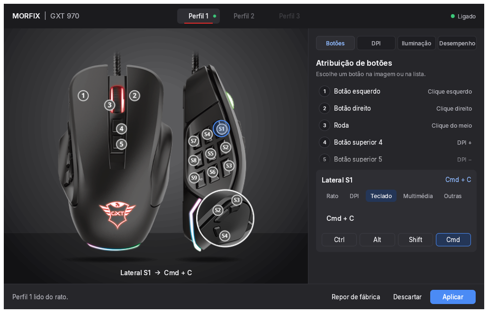
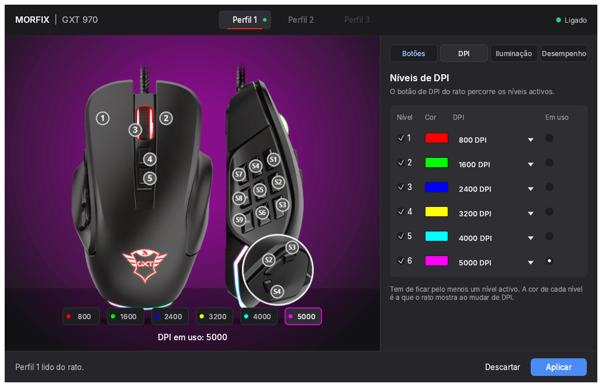
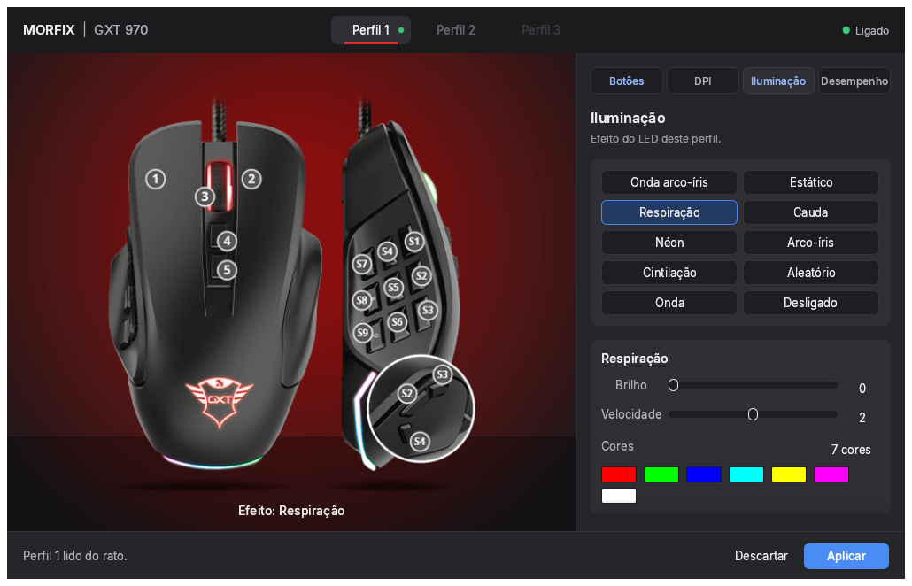

# gxt970

Configuração do rato Trust GXT 970 no macOS, sem o software oficial (que só existe para Windows).

Inclui uma aplicação gráfica e uma linha de comandos em Rust que falam directamente com o rato por HID. O protocolo foi recuperado a partir do instalador oficial para Windows.



## O que faz

- Atribuição de funções aos 14 botões: cliques, roda, DPI, teclas e combinações, multimédia, desactivar.
- DPI: 6 níveis de 200 a 10000, cor de cada nível e nível em uso.
- Iluminação: 10 efeitos (onda arco-íris, estático, respiração, cauda, néon, arco-íris, cintilação, aleatório, onda, desligado), com brilho, velocidade e cores.
- Taxa de actualização: 125, 250, 500 ou 1000 Hz.
- Perfis 1 e 2, com indicação do perfil em uso.
- Cada gravação é lida de volta e comparada com o que foi escrito.

| DPI | Iluminação |
|---|---|
|  |  |

## Requisitos

- macOS (testado num Mac com Apple M1 Pro)
- Rust 1.88 ou mais recente
- Rato Trust GXT 970 (USB `145F:02B9`)

Na primeira utilização, o macOS pede autorização em Definições do Sistema > Privacidade e Segurança > Monitorização de entrada. Autoriza o terminal ou a aplicação que corre o programa.

## Instalação

```sh
git clone https://github.com/fgonga/gxt970.git
cd gxt970
cargo build --release
```

## Utilização

Aplicação gráfica:

```sh
./target/release/gxt970-ui
```

Escolhe o perfil no topo, a secção no painel direito e carrega em Aplicar. A aplicação grava o perfil, confirma a gravação e põe o rato a usar esse perfil.

Linha de comandos:

```sh
gxt970 probe                      # identificação e blocos gerais dos perfis
gxt970 backup ficheiro.bin        # cópia dos blocos gerais
gxt970 buttons 1                  # funções dos botões do perfil 1
gxt970 polling 1 1000             # taxa de actualização do perfil 1
gxt970 dpi 1 6 10000              # nível 6 do perfil 1 a 10000 DPI, em uso
gxt970 restore-dpi 1 ficheiro.bin # repõe os níveis de DPI a partir de um backup
gxt970 activate 2                 # muda o perfil em uso
gxt970 raw 12                     # bloco em bruto (selector em hex)
```

Faz um backup antes da primeira gravação.

## Protocolo

O rato expõe uma interface HID do fabricante (usage page `0xFF00`) com dois feature reports:

- Report 5, 6 bytes: comandos. `[02, 00]` devolve o perfil em uso; `[02, p]` muda para o perfil `p`.
- Report 4, 520 bytes: dados. Lê-se enviando `[sel, 0, 0, 0, 0]` no report 5 e lendo o report 4. Escreve-se com `[04, sel, 00, len, 00 00 00 00, corpo]`.

Selectores: `p<<4 | 1` bloco geral (len `0x7B`, corpo de `0x8C` bytes) e `p<<4 | 2` mapa de botões (len `0x50`, 20 posições de 4 bytes).

Bloco geral (offsets no corpo):

| Offset | Conteúdo |
|---|---|
| `0x02` | taxa (nibble baixo 1..4 = 125..1000 Hz), bit 7 = DPI X/Y separado |
| `0x03` | nível em uso (nibble alto, contado entre os activos) e número de níveis activos |
| `0x04` | máscara de níveis desactivados |
| `0x05..0x0D` | 8 códigos de DPI (índice na tabela 200..10000) |
| `0x15..0x2D` | 8 cores RGB dos níveis de DPI |
| `0x2D` | efeito de LED |
| `0x2E..0x76` | parâmetros e cores de cada efeito (nibble alto = brilho, baixo = velocidade) |

Códigos dos botões (u32 little-endian): `11 xx` rato, `12`/`13` roda e inclinação, `21 mods tecla` teclado (mods HID: Ctrl 1, Shift 2, Alt 4, Cmd 8), `22` multimédia, `31 01 32 n` cliques múltiplos, `41 n` DPI, `50 01` desactivado, `60`/`70` macros.

O perfil 3 não responde a pedidos de leitura neste firmware.

O mapa completo está em `src/general.rs`, `src/buttons.rs` e `src/protocol.rs`.

## Em falta

- Macros
- Reposição de fábrica para DPI e iluminação
- DPI separado para X e Y
- Confirmar no rato a escala de brilho e velocidade (0 a 4)

## Licença

MIT, ver [LICENSE](LICENSE). A imagem do rato e as marcas Trust e GXT pertencem à Trust International B.V.; ver [ATTRIBUTION.md](ATTRIBUTION.md). Projecto independente, sem ligação à Trust.
